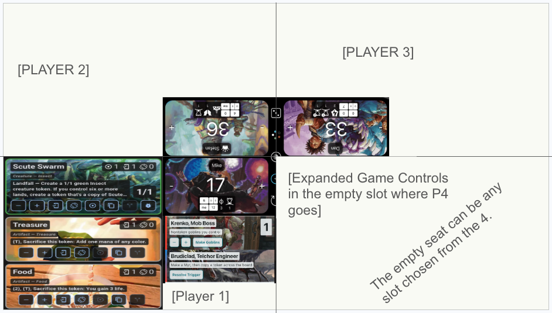
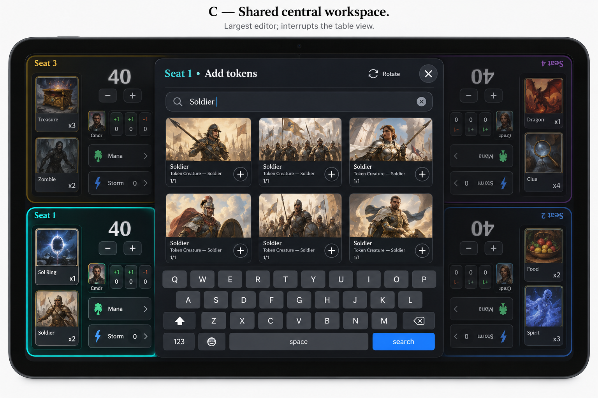

# Layout and interaction

**Status:** D04 accepts customizable 2–4 players. Two-player seat orientation/local lane placement and three-player empty-slot controls are accepted below; other geometry and interaction details remain reviewable (D05–D12).

## Dedicated regions and attached shortcuts — accepted

Each major piece has a dedicated place. Life totals are individual items in their respective corners; in two-player games they occupy opposite corners as in the accepted mockup. Directly beneath each life total, attached commander mini-trackers adjust each source directly; player counters retain a compact shortcut. Each commander tracker uses its owning player’s color/art, including partners and the receiving player’s own commanders. These shortcuts are part of the fixed life region, not reorderable utility entries. Exact measurements and four-player seat/orientation mapping still need a prototype; “corners” does not authorize moving life into either scrolling list.

Each seat has a separate curated utility list. Tablet utility rows do not render color-indicator stripes; retain their color metadata for future use. Token color rails remain unchanged. Hold-and-drag changes utility order; a corner X opens a confirmation modal before hiding that utility for the game. Restore it from the utilities menu. Storm counter and mana pool are **default visible, not mandatory**. Hiding retains stored values, clearing is separate, and nonzero hidden values must remain discoverable. Customization means selecting visibility/order within available kinds, not arbitrary panel resizing or a general-purpose widget authoring system.

Shared controls belong at the life-zone junction with app/game-level origin (D36). The latest 2026-10-22 feedback explicitly rejects a middle control-bearing divider or horizontal strip: use one compact standalone central component in 2/3/4-player layouts. Preserve thin hard player boundaries outside that component and full-height token lanes. Local corner clearance may protect life content; do not reserve a full-zone toolbar band. The selectable empty control slot in three-player mode remains available. The former centered-strip correction is historical and superseded by [the compact-component correction](compact_hub_life_tools_2026-10-22.md). No one-player support is added.

The additional Lifetap reference supplied on 2026-10-21 was visually inspected: four life panels, attached compact shortcut rows and a thin central control strip. It is contextual reference, not an instruction to copy the interface or evidence of an implemented tablet UI.

## Two-player layout — accepted 2026-10-21


The user requests matching, mirrored layouts for two players seated opposite one another. In **each player’s own seated perspective**, the token lane is on the left, life is at the top right, and utilities are beneath life. Opposite-facing seats use 0°/180° presentation: rotating the matched composition changes physical screen left/right, not the player-local order. All keyboard input follows its initiating player, with one keyboard at a time.

The upper half of the supplied sketch is only partially illustrated. Populate it with the matching player-local composition; do not interpret the blank area as a missing token/utility lane. Exact lane widths, target sizes, center-control placement and resize constraints still need prototype measurements. This accepted two-player composition supersedes the generic A/B comparison for that count; it does not settle every four-player quadrant’s composition.

## Three-player layout — accepted 2026-10-21



Use the four-seat base with three occupied player slots. During setup, users can choose **any one of the four slots to be empty**; that slot provides expanded, quicker access to game-level controls such as dice and complete resets. The pictured empty P4 location is an example, not a fixed choice. The user clarified the initial “In 4 player” wording: “I meant 3 player yes. In 3 player, the 4th seat has controls.”

The control slot is not a fourth player: it has no player board/life state, and selecting its location must not reassign stable player identities. Test every empty-slot choice. Exact dimensions, control orientation/content and the remaining occupied-seat geometry need design/prototype work; the image is concept evidence, not implementation. This does not create an empty seat in a four-player game.

Quicker access does **not** mean immediate destructive execution. Full reset still follows the explicit scope/preview, confirmation and recovery design in [life and game controls](03_life_and_game_controls.md); detailed reset semantics remain D22. Dice details remain D28, not an implied turn engine or automatic game-state mutation.

## Reading the original four-player sketch

The image has four quadrants around a central 2 × 2 life tracker. The top two life panels face the opposite side of the table; the bottom two face the viewer. Lower-left demonstrates tokens toward the outer edge, and utilities below that player's life panel toward the center seam. The historic sketch suggests a central location for universal controls; the latest explicit user direction supersedes its strip shape. Only that lower-left quadrant illustrates full content.

The earlier A/B composition comparison is superseded by the accepted dedicated-region and attached-shortcut contract above. Preserve the original sketch as historical context; prototype dimensions and orientation within the accepted structure rather than reopening whether life belongs in a utility lane.

```text
Physical screen, landscape; text rotation omitted here
┌──────────────────────────────┬──────────────────────────────┐
│ P2 tokens │ P2 utilities/menu│P3 utilities/menu │ P3 tokens │
│           ├──────────────────┼──────────────────┤           │
│           │     P2 life      │     P3 life      │           │
│           │          [ GAME CONTROLS ]         │           │
├───────────┼──────────────────┼──────────────────┼───────────┤
│           │     P1 life      │     P4 life      │           │
│           ├──────────────────┼──────────────────┤           │
│ P1 tokens │ P1 utilities/menu│P4 utilities/menu │ P4 tokens │
└──────────────────────────────┴──────────────────────────────┘
```

This is the earlier topology diagram, not an accepted exact wireframe. The center control affordance needs real reserved area; it must not obscure life ± controls. An accessible larger game-control panel may open from a small hub button.

## Seat geometry and orientation

Proposed four-player starting arrangement (not the accepted two-player template):

| Seat | Physical quadrant | Text faces | Outer token side | Inner life / utility side |
|---|---|---|---|---|
| P1 | Lower-left | Bottom of device, 0° | Screen left | Screen right |
| P2 | Upper-left | Top of device, 180° | Screen left | Screen right |
| P3 | Upper-right | Top of device, 180° | Screen right | Screen left |
| P4 | Lower-right | Bottom of device, 0° | Screen right | Screen left |

These labels are illustrative seat names, never database keys. The screenshot implies a two-on-each-long-edge arrangement. A four-edge arrangement with 90°/270° side seats is a separate D05 option, with different available widths and reaching behavior.

**Do not rotate the same entire quadrant template four times and assume the lanes stay correct.** A 180° rotation swaps physical left/right. Compose the desired inner/outer placement, then apply seat orientation with explicit local constraints. Define scroll direction, drag handles, menu anchoring and text input in player-local coordinates. Rotating the device is a viewport change; it is not a request to swap player identities.

Flutter's `RotatedBox` participates in layout for quarter turns. That makes it a candidate for seat-local subtrees; it does not automatically solve overlay placement, keyboard orientation, semantics, or drag proxies. [Official API](https://api.flutter.dev/flutter/widgets/RotatedBox-class.html). See [research](10_research_sources.md) for version/prototype caveats.

## Player-count boundary

The four-quadrant sketch is the reference fixture, not a hard-coded player limit. Initial scope includes customizable two-, three- and four-player tables. Prototype each count deliberately: use the accepted matched opposite-facing two-player layout; three-player setup selects any empty one of four slots for expanded game controls. Do not assume unused screen space must remain blank. Keep stable player identity separate from seat geometry and avoid fixed-four assumptions in the domain. [Expansion to six](../future/six_player_expansion.md) is deferred; preserve layout leeway without implementing or promising it now.

## Persistent seats versus visible slots

The user’s player/seat keeps its name and color/art presets across games. Two-player setup shows seats 1/2 and hides seats 3/4 rather than deleting them; returning to four players restores their customization. Treat visual slot/orientation separately from persistent seat identity, including the selectable empty control slot in three-player mode. Normal game resets retain customization. Seats removed between games clear their game-specific tokens/utilities even when remaining seats keep boards; returning does not resurrect that live setup. Archived games restore their own historical setup separately.

## Seat preset and saved artwork

The seat’s preset-loading flow configures utilities and selected zero-state token entries. An optional deck image can be applied to that seat’s saved life-tracker art without changing the player name. Per-seat art selection must remain independent even when seats load the same preset. This is not arbitrary layout resizing or automatic commander selection. D38 accepts midgame Replace and Append, scoped to the loading seat’s preset-managed fields and each one undoable action. Life values, damage, player counters and timeline are not reset; optional art application UI remains a design detail.

Token-art selections in this flow last for the current game only (D39), unless explicitly carried as keep-board setup or restored from a preset/archive. This does not change the persistent life-tracker appearance or seat name described above; those are different customization domains.

## Life-tracker capacity within the accepted layouts

The centerpiece must accommodate the accepted full tracker, not only ± life. Reserve access to player counters, independent city’s blessing, monarch indication and per-source commander damage including self/partners, while day/night remains one game-level state. Use compact summaries and the accepted shared player-facing workspace for detailed editing, with per-editor application still to be chosen; do not clone Lifetap’s grids/tabs or shrink every control into the life tile. Commander-damage and player-counter access is now fixed as attached shortcuts directly below life. Detailed contents, status presentation and dimensions remain open.

At four players with two commander sources each, each recipient needs access to all eight sources including self (32 ledger pairs across the table). Test long and duplicate names, distinct source labels, counters with large values and simultaneous status indicators. Two-player mirrored composition and all four three-player empty-control-slot choices remain unchanged. An empty control slot is not a player and must never become a counter/damage recipient. Shared controls must remain accessible with four occupied seats too. Numeric/text editors use the one player-facing keyboard; whenever a modal is open, every background control is blocked under D41.

## Space budgets and adaptation

Use logical pixels and actual available constraints, not screenshot pixels or a device-name test. Let usable window width/height be `W/H`, central separation `s`, quadrant dimensions approximately `(W-s)/2` and `(H-s)/2`. Safe areas and any permanent hub reservation must be deducted explicitly.

For layout A, a feasibility estimate is:

```text
quadrantMinWidth  = tokenMinWidth + utilityMinWidth + laneGap + 2*padding
quadrantMinHeight = max(tokenMinHeight, lifeMinHeight + utilityMinHeight + laneGap)
                    + 2*padding
tableMinWidth     = 2*quadrantMinWidth + centerSeparation
tableMinHeight    = 2*quadrantMinHeight + centerSeparation
```

Illustrative starting inputs: token width 280, utility width 200, lane gap 12, padding 12, life height 140, utility height 200, token height 288, center separation 8. This yields roughly **1040 × 760** before additional safe areas or hub deductions. These are prototype inputs, not a supported minimum or an Apple device specification. At an illustrative 1024 × 768 viewport the width already fails this estimate; at 1366 × 1024 there is much more room. Increased text size can fail either size.

Do not shrink every card and touch target to fit. The original dense token action row is deliberate. Fit the existing token implementation into its lane first, retaining direct controls and full functionality. Only a demonstrated fit/accessibility issue justifies an adapted arrangement, with parity evidence; moving actions behind overflow is not the default. Do not confuse adapting the board container with redesigning the token object.

Accepted tablet-first scope requires the complete active 2–4-seat layout, including on small tablets such as iPad mini. Adapt the dedicated regions with compact controls, bounded details and independent scrolling; do not replace the multiplayer board with one focused seat or a phone mode in MVP. The larger shared editor may temporarily obscure the board as already accepted; that is not a permanent focused-seat layout.

Small-tablet fit is required, not an optional fallback test. Exact dimensions, aspect ratios and supported orientations require prototype measurement. The illustrative estimate above is not permission to exclude iPad mini. For a web/window size outside the eventual validated tablet-suitable range, provide explicit resize guidance while preserving state; do not silently add phone/focused-seat support. Never discard game state on resize. Flutter recommends adapting to local/window constraints rather than device type. [Adaptive layout guidance](https://docs.flutter.dev/ui/adaptive-responsive/general).

## Independent lists

- Each player’s two lanes (eight in the four-player fixture) own scroll position, restoration key, reorder state and stable item keys.
- Tokens reorder only among that player's tokens; all supported utility types share that player's utility ordering.
- Life is fixed in its surface and never consumes a list position.
- Default drag cannot cross lane or player boundaries. A future “give control” action must be explicit, not an accidental drop target.
- Utilities use the accepted hold-and-drag method; distinguish its activation from scrolling, tap controls and inline editing. Accessible alternatives remain necessary; token reorder affordances still need design.
- During an order write, disable only the affected ordering domain. Another player can continue life or token actions.
- Define insertion in lane terms: proposed new entries append; split/copy outputs appear next to their source; merged additions retain the target position. See D13.
- If an expanded entry changes height, retain its stable key and sensible viewport position. Another player's edit must not jump this lane.
- A drag proxy and its hit area must remain within the intended surface, including for rotated seats. A regular child clip alone is not proof that an overlay-based proxy is bounded. Flutter exposes a reorder drag-boundary callback; confirm availability on the selected toolchain. [API](https://api.flutter.dev/flutter/material/ReorderableListView/dragBoundaryProvider.html).

**Accepted D41:** any open modal blocks interaction with the entire underlying table. Tapaway dismisses through an app-level overlay and consumes that gesture: no click-through, background mutation, queued second editor, takeover or “busy” notification. One player finishes/dismisses before another opens an editor. This applies to search, editing, confirmations and other modals, not only game-level actions. It does not imply blocking ordinary nonmodal quick controls when no modal is open. No toasts/snackbars for routine feedback, waiting or errors; use in-context status and explicit controls. An exceptional transient notification requires a demonstrated unavoidable need, not convenience.

Current-app behavior informs edit resolution, but does not override this policy. See [existing behavior audit](existing_behavior_audit.md) for search cancellation, inline commit and explicit Save/Cancel distinctions. Dismissing a modal is not necessarily rolling back an already committed action. Failed saves must not be called successful or silently lose their draft; retain recoverable draft/error state without making the modal impossible to dismiss.

## Expansion and editing

**Accepted C: a larger shared central workspace for detailed seat-specific editing and search**, rather than requiring complex editors to remain inside a seat. The workspace identifies the target seat and faces the acting player; its field, results/errors and one custom keyboard share the player-facing orientation. Its central position does not turn a seat-targeted edit into a game-level action or establish strict permissions on who can touch it.



The user selected C from A (seat-contained), B (half-table) and C (large central workspace obscuring most of the table). This generated illustration is **concept evidence, not normative styling or implementation**. It shows a target-seat label, rotation affordance, aligned editor/keyboard and dimmed background. Generated board composition, seat rotations, artwork, keyboard lettering and incidental controls are inaccurate/nonbinding; retain the previously accepted board layout. A visible Rotate control is illustrative, not a settled rotation/handoff mechanism.

Exact dimensions, editor-by-editor application and rotation affordance remain open. D41 settles modal blocking and sequential use: finish/dismiss before another editor opens; no second-editor queue. Do not force every quick counter tap or small adjustment into a giant modal. Inline quick controls can remain; detailed search/editor containment is no longer mandatory. Preserve drafts, failed-save handling and immutable target scope. D10’s earlier per-seat expanded-card proposal does not establish four concurrent large workspaces.

Use the existing operation-specific resolution model, not blanket draft preservation or discard: search/form Cancel abandons unsubmitted intent; inline token edits commit on field exit. While a modal is open, underlying layout/game/reset controls cannot be activated. Background lifecycle or async invalidation must retain failed edits safely and never commit to another seat; see the audit.

## Player menu and shared editing workspace

Every seat has a persistent, reachable menu affordance bearing its player identity. Proposed seat-context groups: Add token; Utilities; Rules; Decks; Player settings. Wipes, resets and history belong to central app/game controls; this is context, not a restriction on which human may use them. “Everything” becomes “P1's tokens” or an equivalent named scope.

Detailed seat-specific search/editing uses the accepted shared workspace direction. Decide which quantity, artwork, counter and deck flows use it versus compact controls; do not assume every editor has identical size. Record `playerId` when opening; carry it through every return value and callback. A screen-space pointer position may choose the originating surface but may never become the durable identity.

A shared workspace host must explicitly manage orientation, focus, target context and any input barrier. D41 now requires app-wide modal background blocking and tapaway dismissal with no click-through; this comes from the user’s explicit follow-up, not from the image alone. `anchorPoint` does not provide arbitrary seat rotation. [Bottom-sheet API](https://api.flutter.dev/flutter/material/showModalBottomSheet.html). Prototype the chosen host rather than assume reused phone sheets satisfy C.

## Simultaneous touch and keyboard

- Different seats' quick controls should accept independent touches without a global “active player” variable.
- Capture a repeating life/mana gesture's player and direction at gesture start. Crossing a seam must not retarget it.
- Cancel repeat on pointer cancel/up, backgrounding, focus loss, panel destruction or session-generation change.
- Two gestures on the same life total must combine deterministically through commands; no read-modify-write lost updates.
- **Confirmed: any keyboard input faces its initiating player**, not only search or rename. This includes custom token/utility text, labels, counters, life, quantities and mana numeric entry wherever those inputs exist. The entry field, keyboard panel and related results/errors must share the player-facing orientation.
- **Chosen direction:** render a custom in-app keyboard within the player-facing Flutter surface. OS/system keyboards do not expose arbitrary per-seat rotation; rotating a Flutter field does not rotate the system keyboard. An in-app panel can be rotated with its seat, but touch mapping, focus, editing and accessibility still need prototype evidence.
- **Concurrency accepted (D09): one keyboard at a time, facing its initiating player.** The user explicitly answered “No simultaneous keyboards.” Preserve drafts and stable player/item origin; one player’s editing must not mutate another’s state. D41 settles sequential modal use: no background request is queued and no takeover occurs. The dismissing gesture is absorbed; another player must initiate a fresh interaction after dismissal. Resolve edited values according to the existing operation’s commit/cancel model.
- Reserve appropriate shared-workspace space, accepting that detailed editing may obscure much of the table. Background input is blocked by D41; exact obstruction/resize dimensions still need validation. System/native fallback, hardware keyboard and IME routes need explicit orientation and accessibility review, not an unnoticed escape from the player-facing requirement.
- [Custom keyboard options](../future/custom_keyboard_options.md), including mana-symbol candidates, are deferred exploration, not approved first-release features.
- Central actions keep app/game context regardless of placement. Any modal blocks the table regardless of action scope; stop underlying repeat gestures when it opens. This UI barrier does not replace durable transaction/generation checks or settle wipe targets.

Flutter distinguishes raw pointers and gesture recognition; nested buttons, drags and repeated controls need deliberate gesture arbitration. [Gesture documentation](https://docs.flutter.dev/ui/interactivity/gestures). Actual multi-seat reliability remains unproven until P0.

## Accessibility and tabletop use

Proposed shared target floor: 48 × 48 logical pixels for primary touch targets, with visible separation, readable text, and no color-only seat identification. Seat name + icon/label should supplement color. Retain contrast over bright artwork with solid backing or an optional plain background. [Flutter accessibility guidance](https://docs.flutter.dev/ui/accessibility).

Give semantics labels such as “Alex, life 37, decrease life by one” and “Sam, Treasure, increase quantity.” Define reading order by player, then life/menu/tokens/utilities, rather than relying on rotated visual position. Validate accessible traversal and controls within the complete tablet multiplayer view; the later MVP scope excludes a focused-seat fallback.

Verify light/dark themes, large text, reduced motion, grayscale, external keyboard navigation, and life legibility from seated distance. Keep global destructive actions away from routine ± taps. Decide haptics/sound at device scope because the same tablet serves every player.

## Game-history access

Provide access to the one game-wide chronological timeline, with meaningful player attribution and distinct game-level origin/affected-seat labels, and undo walking the latest action globally. Do not present independent per-player undo stacks or silently let filtering change undo order. Grouped rows update only until any player performs a different action or a time gap closes the group; token add/remove remain separate. Exact timeline placement and pending/settled/undone presentation are open. Preserve the accepted life/lane geometry, required shared controls and single player-facing keyboard. See [history](game_history_and_undo.md).

## Empty, busy and failure states

An empty lane shows its own Add action and player's name. A busy creation command marks only its originating seat and blocks duplicate submission of that operation. An artwork failure preserves selection and shows a placeholder. A failed save retains the editor or mutation draft and offers retry in the same player's area. A stale panel after a reset explains that the game changed and must not apply its old result.

No routine toasts or snackbars, including seat-local variants or busy announcements. Use inline status, visible results and explicit controls. Existing snackbar calls and non-dismissible phone completion dialogs are not carryover requirements; adapt them to D41.

## Old-design inference checkpoint

The [granular baseline map](outstanding_behavior_baselines.md) supplies concrete starting points for remaining behavior questions, including what current design cannot settle. These are explicitly inferred defaults, not additional accepted requirements; D41 and all earlier explicit decisions take precedence.

## Modifier scope checkpoint — D25

Modifier panels distinguish owned controls from inherited global contributions. Recipient panels cannot independently remove another seat’s source. Local and global applied effects share each seat’s Rules-equivalent panel. Source labels/read-only foreign-source styling are recommended details; no separate screen is mandated. Modal blocking and seat context are unchanged. See [modifier ownership and applicability](modifier_ownership_and_applicability.md).

## Tablet-first MVP boundary — D06/D30

MVP supports tablets from iPad mini through full-size iPads and Android variants, retaining the complete active 2–4-seat view. Android/iOS/web targets remain; web support uses tablet-suitable viewports. Exact minimum dimensions, model generations, OS/browser floors, aspect ratios and orientations require validation, not guesses. Small-tablet fit is mandatory; no MVP phone or focused-seat mode. The [closed-focus/unfolded-multiplayer foldable concept](../future/foldable_phone_future_version.md) is deferred to another major version and does not add a standalone one-player game.

## Explicit carryover clarification — 2026-10-22

Use Lifetap to inform iterative life-tracker arrangement, not as a literal clone. Each seat’s Rules-equivalent panel lists local and global applied effects together; foreign sources stay non-removable there. The Reset menu offers reset with current configuration, complete reset and reload previous game state, mapped to the existing reset/archive contracts. See [source-backed decisions and limitations](implementation_carryover_clarifications.md).

## Full token parity correction — 2026-10-22

The entire original TS token functionality, deliberate density and direct controls must carry over. Reuse the existing token implementation where practical and adapt lane constraints/seat-session integration; a new board container is not a mandate to rebuild or simplify tokens. Any parity-reducing exception requires explicit justification and approval. Review [the source-backed token inventory and acceptance method](token_functional_parity.md), not just row aesthetics or generated mockup styling. No specific runtime mismatch is claimed without implementation evidence.

## Compact controls and restrained chrome — accepted 2026-10-22

The corrective review treats four-player token-lane side as an open consistency
question, not a confirmed defect. Two-player mirrored player-local-left remains
settled. Retain the current four-player composition during this correction and
preserve three-player empty-slot shared controls; illustrative image generation
does not settle a new four-seat geometry.

Use compact, icon-led controls for familiar actions. Avoid allocating rows or large chunks of the board to labeled toolbar furniture when smaller controls provide the same access. Original TS compact/FAB patterns are a precedent, not a mandate to use FABs everywhere. Preserve touch-target usability, direct access and full token functionality rather than achieving density by hiding essential operations.

The player's seat name belongs in that seat's life counter. Do not repeat redundant seat names or “Seat N” labels across the token lane, utility lane and control groups. A shared editor still identifies its target where needed to disambiguate the affected seat; concise contextual identification is not redundant board chrome.

This direction concerns UI chrome and familiar controls, not a ban on meaningful text: token names, rules, values, consequential confirmation wording and necessary disambiguation remain. Icon-led visual controls must retain accessible semantic names and understandable affordances. Do not substitute unlabeled accessibility nodes for visible text labels. Review real layouts for density and control reachability; no unverified implementation defect is asserted here.

## Completed UI feedback batch — accepted 2026-10-22

These explicit revisions supersede older geometry suggestions above. Token name and quantity totals share the first row; retain the original expansion gesture without a chevron. Empty power/toughness uses the real Mana glyphs. Each player-local token lane starts at its first token, without a permanent Add/Summary header. Add is a corner overlay FAB, Summary a compact contextual corner affordance. Reserve scroll-end clearance for the entire final token’s expanded action row above both controls.

City’s Blessing and Monarch are compact enabled/disabled badges. Manual Monarch claim atomically transfers the shared holder with chronological undo; blessing remains local. Commander damage uses individual, directly adjustable attached mini-trackers, styled by each source’s owner. Partners and self-damage remain separate and retain established damage/life coupling.

Every fixed-option utility editor groups readable fields and touch controls side by side so all fixed choices fit small-tablet landscape and portrait. Variable searches, art, previews, and source/target lists may scroll in dedicated regions. Preserve full-table modal blocking, tapaway consumption, recoverable drafts, and the absence of routine toasts. See [implementation and acceptance evidence](ui_feedback_batch_2026-10-22.md).

The user clarified that this feedback applies consistently to iOS/Android tablets and web, even though it was observed on web. Validate font bundling, responsive geometry, touch, keyboard and modal behavior separately on each available target; preserve explicit not-run entries for inaccessible native/browser surfaces.
