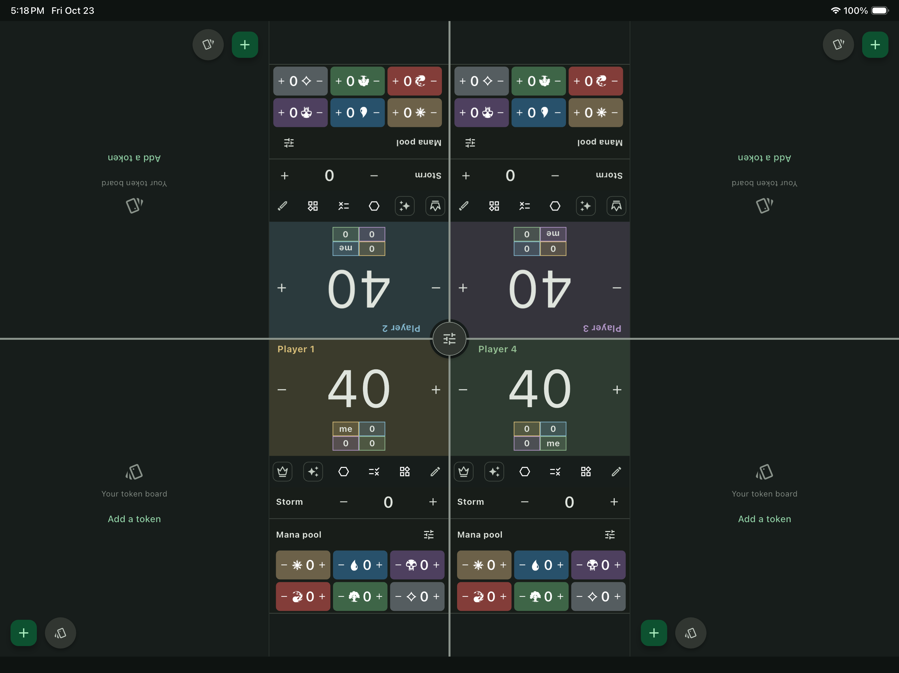

# Physical iPad Release handoff

**Observed:** 2026-10-23 (America/Phoenix).
**Source:** `a79a381` / [PR #47](https://github.com/didymusbenson/Doubling-Season/pull/47),
same source tree as CI-tested feature commit `728f950`.

| Item | Verified result |
|---|---|
| Device | Physical iPad Air 13-inch (M3), iPadOS 26.6.2 |
| App | Tripling Table, `LooseTie.Tripling-Table`, version 0.1.0, build 1 |
| Build | Xcode **Release** configuration, arm64/AOT app; signature verification passed |
| Signing | Existing Apple Development certificate; manually generated development profile containing only the intended registered iPad; no certificate/private key created |
| Installation | `devicectl device install app` succeeded; installed bundle/version/build queried afterward; no uninstall performed |
| Launch | `devicectl device process launch` succeeded; process still present afterward |
| Visible result | Four-player table rendered; screenshot captured through Xcode and inspected |
| Icon | Retrieved installed app icon with placeholders disabled; supplied artwork visually confirmed |
| Source image | Supplied 2048×2048 PNG retained unchanged; all 31 resized platform icons passed dimensions/alpha/catalog checks |

The [icon retrieved from the installed app](validation/ipad-air-m3-installed-icon-2026-10-23.png)
confirms the generated artwork reached this device. Evidence images are copied
unchanged; no device identifier, serial number or signing material is published.

This is build/install/launch evidence, **not a completed gameplay acceptance
run**. It does not prove physical iPad mini support, all 2/3/4-player and
orientation cases, artwork/input accessibility, corruption/failure recovery,
or sustained game performance. Those remain in the [current audit](mvp_readiness_audit.md).
The existing certificate expires November 8, 2026; renewal is separate work.
No TestFlight or App Store upload occurred.
