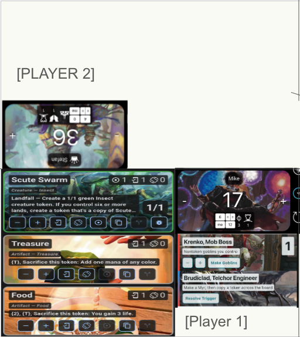

# Layout and interaction

**Status:** D04 accepts customizable 2–4 players. Two-player seat orientation/local lane placement and three-player empty-slot controls are accepted below; other geometry and interaction details remain reviewable (D05–D12).

## Two-player layout — accepted 2026-10-21



The user requests matching, mirrored layouts for two players seated opposite one another. In **each player’s own seated perspective**, the token lane is on the left, life is at the top right, and utilities are beneath life. Opposite-facing seats use 0°/180° presentation: rotating the matched composition changes physical screen left/right, not the player-local order. All keyboard input follows its initiating player, with one keyboard at a time.

The upper half of the supplied sketch is only partially illustrated. Populate it with the matching player-local composition; do not interpret the blank area as a missing token/utility lane. Exact lane widths, target sizes, center-control placement and resize fallback still need prototype measurements. This accepted two-player composition supersedes the generic A/B comparison for that count; it does not settle every four-player quadrant’s composition.

## Three-player layout — accepted 2026-10-21


Use the four-seat base with three occupied player slots. During setup, users can choose **any one of the four slots to be empty**; that slot provides expanded, quicker access to game-level controls such as dice and complete resets. The pictured empty P4 location is an example, not a fixed choice. The user clarified the initial “In 4 player” wording: “I meant 3 player yes. In 3 player, the 4th seat has controls.”

The control slot is not a fourth player: it has no player board/life state, and selecting its location must not reassign stable player identities. Test every empty-slot choice. Exact dimensions, control orientation/content and the remaining occupied-seat geometry need design/prototype work; the image is concept evidence, not implementation. This does not create an empty seat in a four-player game.

Quicker access does **not** mean immediate destructive execution. Full reset still follows the explicit scope/preview, confirmation and recovery design in [life and game controls](03_life_and_game_controls.md); detailed reset semantics remain D22. Dice details remain D28, not an implied turn engine or automatic game-state mutation.

## Reading the original four-player sketch

The image has four quadrants around a central 2 × 2 life tracker. The top two life panels face the opposite side of the table; the bottom two face the viewer. Lower-left demonstrates tokens toward the outer edge, and utilities below that player's life panel toward the center seam. The thin central strip suggests a location for universal controls. Only that lower-left quadrant illustrates full content.

For the original four-player arrangement, two interpretations still need a deliberate choice:

| Layout | What it means | Tradeoff |
|---|---|---|
| A: screenshot-first, proposed starting point | Token lane fills the outer part of each quadrant; life occupies the central end of the inner column; utilities fill the remainder of that inner column | Preserves the strongest visual cues; utilities lose vertical space to life |
| B: life above both lanes in player-local coordinates | Each quadrant has a life/header band and two lanes beneath | Simpler local layout; reduces token height and makes the life hub less visually compact |

Prototype A and retain B as the first comparison, rather than deciding from artwork alone. “Beneath” must be interpreted from each player's seated perspective. The central hub should be visually unified but must not become an overlapping hit-test surface that covers the lists.

```text
Physical screen, landscape; text rotation omitted here
┌──────────────────────────────┬──────────────────────────────┐
│ P2 tokens │ P2 utilities/menu│P3 utilities/menu │ P3 tokens │
│           ├──────────────────┼──────────────────┤           │
│           │     P2 life      │     P3 life      │           │
│           │          [ GAME CONTROLS ]         │           │
├───────────┼──────────────────┼──────────────────┼───────────┤
│           │     P1 life      │     P4 life      │           │
│           ├──────────────────┼──────────────────┤           │
│ P1 tokens │ P1 utilities/menu│P4 utilities/menu │ P4 tokens │
└──────────────────────────────┴──────────────────────────────┘
```

This is a topology diagram, not an exact wireframe. The center control affordance needs real reserved area; it must not obscure life ± controls. An accessible larger game-control panel may open from a small hub button.

## Seat geometry and orientation

Proposed four-player starting arrangement (not the accepted two-player template):

| Seat | Physical quadrant | Text faces | Outer token side | Inner life / utility side |
|---|---|---|---|---|
| P1 | Lower-left | Bottom of device, 0° | Screen left | Screen right |
| P2 | Upper-left | Top of device, 180° | Screen left | Screen right |
| P3 | Upper-right | Top of device, 180° | Screen right | Screen left |
| P4 | Lower-right | Bottom of device, 0° | Screen right | Screen left |

These labels are illustrative seat names, never database keys. The screenshot implies a two-on-each-long-edge arrangement. A four-edge arrangement with 90°/270° side seats is a separate D05 option, with different available widths and reaching behavior.

**Do not rotate the same entire quadrant template four times and assume the lanes stay correct.** A 180° rotation swaps physical left/right. Compose the desired inner/outer placement, then apply seat orientation with explicit local constraints. Define scroll direction, drag handles, menu anchoring and text input in player-local coordinates. Rotating the device is a viewport change; it is not a request to swap player identities.

Flutter's `RotatedBox` participates in layout for quarter turns. That makes it a candidate for seat-local subtrees; it does not automatically solve overlay placement, keyboard orientation, semantics, or drag proxies. [Official API](https://api.flutter.dev/flutter/widgets/RotatedBox-class.html). See [research](10_research_sources.md) for version/prototype caveats.

## Player-count boundary

The four-quadrant sketch is the reference fixture, not a hard-coded player limit. Initial scope includes customizable two-, three- and four-player tables. Prototype each count deliberately: use the accepted matched opposite-facing two-player layout; three-player setup selects any empty one of four slots for expanded game controls. Do not assume unused screen space must remain blank. Keep stable player identity separate from seat geometry and avoid fixed-four assumptions in the domain. [Expansion to six](six_player_expansion.md) is deferred; preserve layout leeway without implementing or promising it now.

## Persistent seats versus visible slots

The user’s player/seat keeps its name and color/art presets across games. Two-player setup shows seats 1/2 and hides seats 3/4 rather than deleting them; returning to four players restores their customization. Treat visual slot/orientation separately from persistent seat identity, including the selectable empty control slot in three-player mode. Normal game resets retain customization. Seats removed between games clear their game-specific tokens/utilities even when remaining seats keep boards; returning does not resurrect that live setup. Archived games restore their own historical setup separately.

## Life-tracker capacity within the accepted layouts

The centerpiece must accommodate the accepted full tracker, not only ± life. Reserve access to player counters, independent city’s blessing, monarch indication and per-source commander damage including self/partners, while day/night remains one game-level state. Use compact summaries and a bounded player-facing detail surface as design candidates; do not clone Lifetap’s grids/tabs or shrink every control into the life tile. Exact placement and visibility defaults remain open.

At four players with two commander sources each, each recipient needs access to all eight sources including self (32 ledger pairs across the table). Test long and duplicate names, distinct source labels, counters with large values and simultaneous status indicators. Two-player mirrored composition and all four three-player empty-control-slot choices remain unchanged. An empty control slot is not a player and must never become a counter/damage recipient. Shared controls must remain accessible with four occupied seats too. Numeric/text editors use the one player-facing keyboard and preserve drafts; non-typing controls remaining usable stays the recommendation.

## Space budgets and adaptation

Use logical pixels and actual available constraints, not screenshot pixels or a device-name test. Let usable window width/height be `W/H`, central separation `s`, quadrant dimensions approximately `(W-s)/2` and `(H-s)/2`. Safe areas and any permanent hub reservation must be deducted explicitly.

For layout A, a feasibility estimate is:

```text
quadrantMinWidth  = tokenMinWidth + utilityMinWidth + laneGap + 2*padding
quadrantMinHeight = max(tokenMinHeight, lifeMinHeight + utilityMinHeight + laneGap)
                    + 2*padding
tableMinWidth     = 2*quadrantMinWidth + centerSeparation
tableMinHeight    = 2*quadrantMinHeight + centerSeparation
```

Illustrative starting inputs: token width 280, utility width 200, lane gap 12, padding 12, life height 140, utility height 200, token height 288, center separation 8. This yields roughly **1040 × 760** before additional safe areas or hub deductions. These are prototype inputs, not a supported minimum or an Apple device specification. At an illustrative 1024 × 768 viewport the width already fails this estimate; at 1366 × 1024 there is much more room. Increased text size can fail either size.

Do not shrink every card and touch target to fit. Current phone cards have a dense action row; narrow lanes need a purpose-built compact view with primary controls and overflow/expansion for secondary actions. Reuse the behaviors, not their exact row arrangement.

Proposed adaptation ladder:

1. **Roomy table:** full four-seat overview, both lanes visible, central life hub.
2. **Constrained table:** compact card controls, bounded life detail, optional seat-local lane-width adjustment. Do not hide a whole lane without an obvious selector and count.
3. **Focused seat fallback:** persistent compact life overview plus one selected player's full workspace; preserve all players' state and label the focused seat. This relaxes simultaneous four-workspace visibility and requires D06 approval.

If fallback is rejected, state the supported minimum and offer a clear “enlarge window / rotate device” state. Never discard game state on resize. Flutter recommends adapting to local/window constraints rather than device type. [Adaptive layout guidance](https://docs.flutter.dev/ui/adaptive-responsive/general).

## Independent lists

- Each player’s two lanes (eight in the four-player fixture) own scroll position, restoration key, reorder state and stable item keys.
- Tokens reorder only among that player's tokens; all supported utility types share that player's utility ordering.
- Life is fixed in its surface and never consumes a list position.
- Default drag cannot cross lane or player boundaries. A future “give control” action must be explicit, not an accidental drop target.
- Use an intentional reorder handle or explicit reorder mode to distinguish scrolling, tap controls, inline editing and drag.
- During an order write, disable only the affected ordering domain. Another player can continue life or token actions.
- Define insertion in lane terms: proposed new entries append; split/copy outputs appear next to their source; merged additions retain the target position. See D13.
- If an expanded entry changes height, retain its stable key and sensible viewport position. Another player's edit must not jump this lane.
- A drag proxy and its hit area must remain within the intended surface, including for rotated seats. A regular child clip alone is not proof that an overlay-based proxy is bounded. Flutter exposes a reorder drag-boundary callback; confirm availability on the selected toolchain. [API](https://api.flutter.dev/flutter/material/ReorderableListView/dragBoundaryProvider.html).

## Expansion and editing

Proposed: at most one expanded token/utility **per player**, so four seats can inspect different objects concurrently. Whether one token and one utility can both expand for a single player is D10; one across both lanes is the simpler starting point. Preserve failed-save vetoes and pending editor content.

Expansion stays in the lane where the item belongs. Do not reintroduce a full-screen phone detail route to avoid the layout work. If a lane cannot contain a complex editor, use a seat-local panel with a clear originating object. Closing P1's panel cannot collapse P2's card.

Changing layout, opening game controls, deleting the current object, and starting a new game all need an editor-resolution policy: commit and await, ask to discard, or veto. Silent discard is never an acceptable default.

## Player menu and local panels

Every seat has a persistent, reachable menu affordance bearing its player identity. Proposed seat-context groups: Add token; Utilities; Rules; Decks; Player settings. Wipes, resets and history belong to central app/game controls; this is context, not a restriction on which human may use them. “Everything” becomes “P1's tokens” or an equivalent named scope.

Token/utility search, quantity input, artwork selection, counters and deck selection should render in a bounded panel associated with that player. Record `playerId` when opening; carry it through every return value and callback. A screen-space pointer position may choose the originating surface but may never become the durable identity.

A root modal bottom sheet prevents interaction with the rest of the app. `anchorPoint` relates to display-feature sub-screens, not arbitrary tabletop quadrants. Reusing current sheets unchanged would undermine independent play. [Bottom-sheet API](https://api.flutter.dev/flutter/material/showModalBottomSheet.html). Candidate implementation: bounded per-seat navigator/overlay or an explicit panel host, validated for barriers and focus. A nested navigator alone is not proof of clipping. [Navigator documentation](https://api.flutter.dev/flutter/widgets/Navigator-class.html).

## Simultaneous touch and keyboard

- Different seats' quick controls should accept independent touches without a global “active player” variable.
- Capture a repeating life/mana gesture's player and direction at gesture start. Crossing a seam must not retarget it.
- Cancel repeat on pointer cancel/up, backgrounding, focus loss, panel destruction or session-generation change.
- Two gestures on the same life total must combine deterministically through commands; no read-modify-write lost updates.
- **Confirmed: any keyboard input faces its initiating player**, not only search or rename. This includes custom token/utility text, labels, counters, life, quantities and mana numeric entry wherever those inputs exist. The entry field, keyboard panel and related results/errors must share the player-facing orientation.
- **Chosen direction:** render a custom in-app keyboard within the player-facing Flutter surface. OS/system keyboards do not expose arbitrary per-seat rotation; rotating a Flutter field does not rotate the system keyboard. An in-app panel can be rotated with its seat, but touch mapping, focus, editing and accessibility still need prototype evidence.
- **Concurrency accepted (D09): one keyboard at a time, facing its initiating player.** The user explicitly answered “No simultaneous keyboards.” Preserve drafts and stable player/item origin; one player’s editing must not mutate another’s state. D11 still needs a deliberate handoff/request policy. Do not infer automatic takeover, cancellation, submission or draft discard when another player requests input. Keeping other players’ non-typing quick controls responsive remains the recommended behavior.
- Reserve bounded panel space without lifting all lanes into unusable heights. Preserve life access where practical and record the chosen obstruction/resize policy. System/native fallback, hardware keyboard and IME routes need explicit orientation and accessibility review, not an unnoticed escape from the player-facing requirement.
- [Custom keyboard options](custom_keyboard_options.md), including mana-symbol candidates, are deferred exploration, not approved first-release features.
- Central actions keep app/game context regardless of placement. A global input pause/barrier, editor resolution and repeat-gesture policy during wipes/resets remain open; do not treat a table-wide lock as accepted.

Flutter distinguishes raw pointers and gesture recognition; nested buttons, drags and repeated controls need deliberate gesture arbitration. [Gesture documentation](https://docs.flutter.dev/ui/interactivity/gestures). Actual multi-seat reliability remains unproven until P0.

## Accessibility and tabletop use

Proposed shared target floor: 48 × 48 logical pixels for primary touch targets, with visible separation, readable text, and no color-only seat identification. Seat name + icon/label should supplement color. Retain contrast over bright artwork with solid backing or an optional plain background. [Flutter accessibility guidance](https://docs.flutter.dev/ui/accessibility).

Give semantics labels such as “Alex, life 37, decrease life by one” and “Sam, Treasure, increase quantity.” Define reading order by player, then life/menu/tokens/utilities, rather than relying on rotated visual position. Offer a single-orientation accessibility/focused view if VoiceOver traversal around four rotations is confusing; D12 settles that behavior.

Verify light/dark themes, large text, reduced motion, grayscale, external keyboard navigation, and life legibility from seated distance. Keep global destructive actions away from routine ± taps. Decide haptics/sound at device scope because the same tablet serves every player.

## Game-history access

Provide access to the one game-wide chronological timeline, with meaningful player attribution and distinct game-level origin/affected-seat labels, and undo walking the latest action globally. Do not present independent per-player undo stacks or silently let filtering change undo order. Grouped rows update only until any player performs a different action or a time gap closes the group; token add/remove remain separate. Exact timeline placement and pending/settled/undone presentation are open. Preserve the accepted life/lane geometry, required shared controls and single player-facing keyboard. See [history](game_history_and_undo.md).

## Empty, busy and failure states

An empty lane shows its own Add action and player's name. A busy creation command marks only its originating seat and blocks duplicate submission of that operation. An artwork failure preserves selection and shows a placeholder. A failed save retains the editor or mutation draft and offers retry in the same player's area. A stale panel after a reset explains that the game changed and must not apply its old result.

No table-wide snackbar is assumed. Use local inline status for routine results and explicit local/global completion controls for destructive operations, adapting the current undo pattern to the correct scope.
