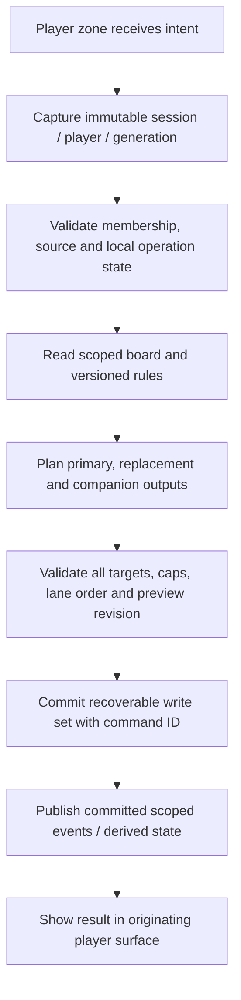

# Player isolation and rules

**Status:** proposed safety architecture. Preventing accidental cross-player changes is confirmed C09. Names below describe contracts, not implemented APIs.

## Non-negotiable behavior

For an ordinary player action, the complete causal chain belongs to the originating player's session: source reads, rules selection, result planning, primary and companion creation, merge lookup, counters, trigger accumulation, order allocation, persistence, feedback, rollback and undo. It must never acquire a different destination because someone else touched a menu while an async operation was pending.

The current single-board app uses app-wide providers, fixed Hive boxes, singleton events, whole-board queries and snapshots. Those are appropriate current single-board assumptions, not existing multiplayer defects. [Current-code evidence](../../../../ai_docs/research/2026-10-20-ipad-edition-current-architecture.md) identifies each adaptation point.

## Identity and scope vocabulary

| Identity | Purpose | Must not be substituted with |
|---|---|---|
| `sessionId` | Which game owns the state | Current screen route |
| `sessionGeneration` / `playerGeneration` | Invalidate work from before a table reset or a local reset/replacement respectively | Widget mount status alone |
| `playerId` | Stable participant in the session | Display name, color, list index, quadrant |
| `seatId` | Current position/orientation | Player ownership |
| `entityId` | Stable token stack / utility identity | Bare Hive key without namespace |
| `commanderId` | Stable source commander associated with an owning PlayerId; distinct partners | Owner PlayerId, recipient PlayerId, display name or seat |
| `commandId` | One submitted intent, used for retries/deduplication | Button label or timestamp alone |
| `causationId` | Link derived results/events to their initiating command | Last active utility |
| `revision` | Detect stale source/rules/plan state | Global mutable selection |

An ordinary command carries immutable session/player identity, both session and player generations, relevant entity IDs/revisions, and a unique command ID. A whole-game reset advances the session generation. A local reset/replacement advances only the affected player's generation when its pending work must be invalidated; other players' valid pending commands remain valid. Validate both generations before commit. Global commands carry an explicit affected-player set and may only be issued through the game-level controller. These are local correctness capabilities, not security credentials or network authentication.

Proposed invalidation policy for D22: clearing/replacing a player's board, replacing that participant, or applying a live-board import advances that player's generation and cancels their pending board work. A life-only correction/reset, ordinary reorder, or seat swap uses relevant revisions without invalidating unrelated token creation. Exact generation domains must be settled alongside reset semantics; do not advance the whole session to implement a local reset.

The control that receives a gesture identifies the actor. The software cannot identify the human finger. Default actor and target are the same player. Future gifts, control changes or multi-player life effects must explicitly name different targets; no drag across a seam implies consent or a change of controller.

Magic token ownership and control are distinct concepts from seating: a token's creator owns it and it enters under that player's control. [Rule 111.2](https://media.wizards.com/2026/downloads/MagicCompRules%2020260925.txt). Proposed first scope can use one board player identity when transfers are unsupported, but must document that simplification and avoid naming it a universal ownership model. D25 decides whether owner/controller fields are needed immediately.

## Life-tracker scope distinctions

D26 now requires player life/counters/city’s blessing, shared monarch/day-night and commander damage including self. Local counter/status commands capture the target PlayerId and typed field, with no token-creation or token-counter-rule side effects. A damage command names recipient PlayerId and source CommanderId separately; the source owner may equal the recipient, and partners never collapse into one player key. Selecting a source does not make its owner the mutation target.

Monarch assignment/transfer and day/night changes are explicit table-state commands, even when invoked from a player’s panel. Preserve actor attribution, shared-state revision and before/after values; one holder update must not create two monarchs. City’s blessing remains independently local to each player. A shared-state undo must detect a later conflicting shared change rather than restore a whole-table snapshot. No tracking command implies automatic combat, ascend, card draws, milling, turn transitions or KO. Coupled damage/life policy and reset retention remain open; if coupling is chosen both effects form one recoverable write set.

## Proposed command pipeline

Failure at validation produces no writes. Failure during commit produces an explicit incomplete/recovered outcome; retry must not duplicate outputs. Events and derived utilities must be reconciled as part of the same logical command or a durable deduplicated follow-up. Do not call a multi-record operation “atomic” simply because it is awaited or runs on one isolate.

## Enforce scope below rendering

1. Queries used for gameplay must require a scope and return only eligible records. Unscoped catalog queries are separately named and contain definitions, not live boards.
2. Every mutation validates session membership, generation and target ownership/controller before writing.
3. Merge candidates must share session and relevant board controller before existing token/artwork/counter compatibility is checked.
4. Order allocation and replay are restricted to `(sessionId, playerId, lane)`.
5. Events carry scope and command provenance. Listeners state their applicability; they do not infer it from whichever provider is nearest in the UI.
6. Do not expose unrestricted mutable Hive objects to reused UI that can bypass commands through setters or `.save()` / `.delete()`. Migrate those paths or provide genuinely scoped storage handles with validation.
7. Missing/invalid context fails closed with a local error. Never silently default to seat 1, the most recent seat, or the whole table.

Per-seat providers are useful read projections and controllers. Constructing four copies of the current providers still opens the same boxes and preference keys; it is not an isolation mechanism.

## Creation trace: P1 makes a Treasure

Assume P1 enables a local Manufactor calculation and a local Chatterfang calculation; P2 has matching named stacks. This is an isolation example, not a new claim about replacement-effect math.

1. P1 opens search; the flow records session S, player A, generation 7.
2. P2 opens a utility panel. P1's captured scope does not change.
3. The quantity preview uses A's rule revision and board reads. Preserve the existing evaluator's ordering and per-event result semantics.
4. The evaluator returns the primary/peer/companion results with one retained scope and causation chain.
5. Every merge lookup is limited to A's eligible stacks; P2's Treasure is never considered even if all card fields match.
6. Primary outputs and all companions get A's token-lane positions. A zero-result branch creates nothing and emits no false entry event.
7. Relevant scoped creature-entry events update only applicable utilities. Derived tracker saves are awaited or durably queued with deduplication.
8. Completion and any cap/error feedback appear in A's surface.
9. Retry with the same command ID returns its outcome rather than creating another batch.
10. If a reset advanced generation to 8 before commit, reject the obsolete command. Do not repopulate the reset game.

## Mutation coverage inventory

Every route below must use the new boundary. Fixing only the new-token button is insufficient.

| Route | Scope-sensitive reads/writes | Required check |
|---|---|---|
| Life / typed player counter / blessing | Target player, field type, before/after and revision | One authoritative local value; no implicit token or shared-state mutation |
| Commander damage / correction | Recipient PlayerId, source CommanderId (self permitted), ledger revision; life only if selected policy | Separate partners; no source-owner retargeting; coupled writes/undo atomic if approved |
| Monarch / day-night | Explicit shared-state revision, old/new holder or designation and actor | One coherent shared value; stale undo cannot clobber newer transfer; no local copy drift |
| Search / custom create | Quantity, rules, custom library selection, artwork, primary and companions | Destination retained across every await |
| Increment / copy / Scute | Source stack, totals, rules, merge and companions | No other player's identical stack used |
| Split / counter-on-one | Source status/counters, new stack, order | Same player/lane; redistribution must not emit false creation events |
| Token editing | Direct model setters, queued status/counter writes, artwork results | Source still exists in same generation and scope |
| Krenko variants / Hare | Controlled token counts and utility state | Source utility and board belong to same command scope |
| Manufactor action | Forced utility count, preset interaction, peer outputs | Preserve existing non-double-counting semantics within player |
| Cathars | Pending triggers, creature enumeration, counter modifiers | Event applicability and counter recipients explicit |
| Rhys | Preview source set, rule revision, copied outputs/merge | Scoped plan; reject/recompute stale preview |
| Brudiclad | Candidate picker, virtual creations, transforms, sickness cleanup | All targets and undo local; other seats excluded |
| Untap / sickness / counters-all | Bulk recipient enumeration | Explicit player default; table recipients explicit |
| Utility creation/reset/toggle | Definition versus live state, utility append order | Correct utility lane and authoritative value |
| Deck append/replace/save | Destination, captured templates, both lane orders | Shared library does not imply shared live board |
| Wipe / reset / undo | Deleted entities, rules, triggers, order, life as selected | Restore only affected state; never whole-box local restore |
| Reorder / journal replay | Source/destination, normalization, replay namespace | Same session/player/lane |
| Seat change/elimination | Participant membership and outstanding callbacks | Seat is not identity; replacement does not inherit stale work |
| Import / native picker | Delayed returned selection, file paths, route closing | Revalidate original scope after OS handoff |

## Event contract

Proposed committed event envelope: event ID, command/causation ID, session ID, session/player generations, source player/controller, affected entities/players, event kind and semantic amount. Capture immutable event-time token identity/characteristics needed by listeners, or persist the fully evaluated derived effects. A queued listener must not inspect a mutable current Item after it has been transformed, edited or deleted and reinterpret what entered. Event consumers must be registered against explicit applicability, not a global active player.

Separate `PlayerTokensCleared`, `PlayerBoardReset`, and `GameRestarted` semantics; one payload-free “board wipe” event is insufficient. Restoration/recovery events must not masquerade as fresh battlefield entries. Replaying durable commands must not double-count Cathars triggers.

Existing per-event versus display-aggregated rule outputs matter: two underlying creation events can have different trigger consequences from one merged display row. Keep mathematical/event identity independent of UI list aggregation and player scope.

## Local effects versus actual table effects

Player isolation prevents accidental cross-player mutations. It must not prevent intentional multi-player effects. Some existing preset names represent cards with broader applicability. A new shared table must choose what those controls mean.

Proposed initial behavior is an explicitly local calculation configuration for each player, matching the current personal-board workflow. Label it as such. Do not silently broadcast a locally enabled preset, and do not claim automatic full-table rules accuracy. Future shared effects need separate records describing effect controller, applicability predicate, lifetime, rule ordering and affected players; their result writes remain explicit and traceable. D25 blocks any assertion of general multiplayer rules support.

Likewise, life, mana, player counters and token counters are different domains. The current token/counter modifiers cannot be applied to all numeric values indiscriminately.

## Concurrency and undo

Proposed initial model: per-player intent queues feed one authoritative session writer, with a table coordinator for overlapping multi-player operations. UI remains responsive; sequential durable writes are not global input locks. Independent scoped writers are an alternative under D15, not the default established here; that alternative needs deterministic scope acquisition or equivalent coordination to prevent deadlocks.

Use current source/rules revisions to reject stale planners, not a whole-table revision that makes P1's preview stale whenever P2 changes life. For rule changes while a preview is open, proposed default is to require a refresh/reconfirmation; D15 may choose a documented snapshot policy instead.

Local destructive actions can hold that player's affected domain until Undo/Accept. Other players continue. If the same player can mutate affected state while undo is pending, use write-set inverse operations and conflict detection. Never restore an old player aggregate over that player's later unrelated changes without explaining the rollback boundary. Global destructive undo holds a table barrier or requires a full conflict-aware history implementation. See [data design](06_data_persistence_and_migration.md).

## Failure cases to design explicitly

- Food is durable but Clue creation fails: retry creates only missing outputs or the operation is recovered as one coherent unit.
- Token creation rolls back after a trigger listener started saving: derived utility state must also recover, without a late save resurrecting the increment.
- A split callback fires after its source was deleted, transferred, or its session reset: reject it with no new orphan stack.
- A native artwork picker returns after a seat swap: same player receives the result if still valid; the new occupant of that seat does not.
- A replay record has no recognized player/lane: quarantine/report the operation; never guess a target.
- A local undo runs after P2 creates tokens: P2's new entities, rules, life and orders are unchanged.

P0/P1 delivery gates and V10–V29 in [validation](08_delivery_validation_and_risks.md) make these contracts reviewable. No isolation guarantee has been validated by this documentation alone.
