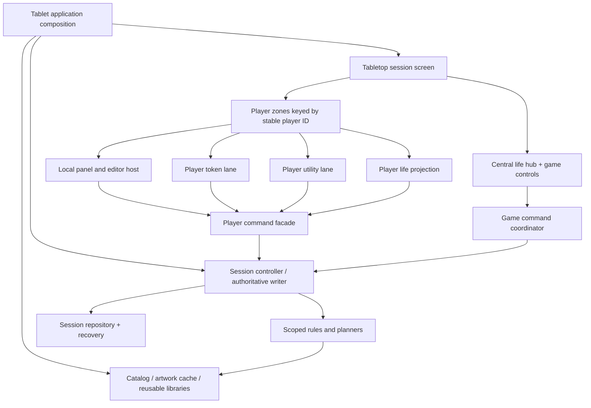

# Architecture and reuse

**Status:** proposed architecture; separate-product and Android/iOS/web targets are accepted; exact packaging, release sequencing and storage choices remain open. No application, package, dependency or build configuration has been changed.

**Accepted presentation boundary:** dedicated life regions with attached commander-damage/player-counter shortcuts, separate curated utility lists and a separate shared-controls panel. Utility visibility/order is presentation state, distinct from stored values; storm/mana default visible can be hidden and restored. Keep these boundaries in renderer/controller interfaces, not a single draggable/resizable dashboard. Shared controls use a between-paired-seats strip/panel for three/four players and a thin shortcut divider for two. Exact dimensions and reset default provisioning remain open.

**Accepted reusable-setup boundary (D38):** evolve Decks into saved token-list/utility-preference presets loaded into a chosen seat with zero-state token entries. Optional deck art can supply saved life art for that seat. Keep reusable templates, per-seat mutable artwork selections, active runtime entities and full-session archives separate; existing DeckProvider clear/append methods are reference behavior, not approved tablet midgame semantics.

## Chosen Flutter direction

Retain Flutter. The needs identified here—bounded layouts, rotated subtrees, multiple input surfaces, independent scrollable lists, local panels, semantics and shared Dart domain logic—fit framework capabilities described in the [official research](10_research_sources.md). The existing app already supplies the token catalog, artwork, arithmetic, utilities and storage knowledge.

Flutter with a custom player-facing in-app keyboard is the chosen direction. This is not a claim that multi-player touch, rotated input or target-device performance have already passed. The hard unknowns are geometry and interaction, followed by state isolation/recovery. A native rewrite would still need the same player model and correctness work.

Reconsider only after a small reproducible hardware prototype establishes a critical unresolved problem: unacceptable touch/semantics behavior, essential platform integration unavailable through a bounded bridge, or unacceptable frame/input behavior after measured remediation. A broken package or awkward current widget is not by itself a reason to replace the UI framework. A local store can also change without changing Flutter.

## New project versus new distribution

D01 accepts a separate app / new product. The same repository is acceptable with properly isolated directories, but no final workspace/package layout is mandated. D24 still governs the shared-core boundary. Alternatives below retain context, not equal approval status:

| Option | Advantages | Costs / unanswered questions |
|---|---|---|
| Separate Flutter app in a shared workspace | Independent shell, identifiers, release cadence; one reusable Dart core | Package extraction and two-app validation; tooling/workspace shape to choose |
| Separate repository consuming a versioned shared package | Clear product ownership and releases | Package publishing/versioning, cross-repository coordination, asset delivery |
| Distinct edition entry point inside existing distributable (not selected) | Shared installation/library and fewer release pipelines | Superseded by the separate-app decision; do not implement an existing-app mode instead |
| Long-lived copy/fork | Quick prototype independence | Fixes and behavior drift; ongoing duplicated maintenance |

Implementation proposal within the accepted separate-app boundary: prototype the tablet shell against explicit domain interfaces, then extract only proven shared domain/catalog infrastructure. Do not create a new repository, app identity, or release target merely to document this feature. Do not extract all phone code before proving the interaction concept.

## Existing reuse map

All current-code statements below are supported by the [pinned audit](../../../../ai_docs/research/2026-10-20-ipad-edition-current-architecture.md). Reuse classification means engineering intent, not drop-in compatibility.

| Existing area | Reuse intent | Adaptation boundary |
|---|---|---|
| Life-tracker foundation (new) | Accepted life/counter/status/damage capabilities, not four copies of generic utilities | Typed player values, stable CommanderId/recipient ledger, shared monarch/day-night commands and projections; no copied Lifetap UI |
| TokenDefinition / bundled and remote catalog | Strong reuse | Shared read-only definitions; independent live entity identity |
| Search filters/tabs/custom definitions | Reuse data and selection behavior | Make board mutation caller-owned; render in bounded player panels |
| Rules evaluation/results | Reuse mathematics and per-event semantics | Inject selected player's configuration; add provenance and explicit global applicability |
| TokenCreationService / merge predicate | Reuse one creation boundary and identity rules | Required scope, local eligible queries, durable complete-result handling |
| Item and counter semantics | Reuse domain behavior | DTO/model boundary to prevent direct unscoped Hive writes |
| Rhys / Brudiclad planners | Reuse planning logic where independent | Filter inputs, validate revisions and targets, adapt undo/order |
| TrackerWidget / ToggleWidget definitions | Reuse definitions and known actions | Runtime instances/player commands separated from widget action dispatch |
| Artwork/cache/credits | Strong reuse | Shared cache, explicit per-entity selection, local route closures and retained upload scope |
| Deck definitions/import/export | Reuse setup content via adapter | Player target, independent lanes, version handling; no implied live-session save |
| Hive setup/schema knowledge | Reuse compatibility lessons | New namespace and coherent session recovery; existing boot backup is insufficient proof |
| BoardOrderPersistence | Reuse journaling/recovery ideas | New independent order domains; no hidden mixed-list canonical order |
| BoardUndoSnapshot | Reuse snapshot/restoration semantics | Replace whole-box local restoration with scoped affected-state restore |
| ExpandableCardController / edit sessions | Reuse save-veto and focused-editor principles | Per-player interaction state and keyboard coordinator |
| TokenCard and utility cards | Canonical behavior/visual reference | New narrow-lane composition and control arrangements; do not mount four ContentScreens |
| Settings / updates / IAP | Reuse platform integration selectively | Device versus player settings explicit; defer intrusive maintenance during play |

## Proposed component graph

Life, typed player counters/status and commander damage can appear in the central hub and player-focused views; both read the same authoritative state. D26 requires self-source and distinct partner ledgers, independent city’s blessing, a shared monarch holder and shared day/night. The session controller must represent these typed local/shared domains, not a collection of unrelated numeric utilities. UI source evidence from Lifetap does not supply ready-made code or an approved interface. The graph does not require duplicating life state in each visual component. Likewise, a mana utility is a projection of its authoritative per-player value, not six unrelated generic trackers.

## Proposed contracts

- **History projection/grouping:** one chronological game log with meaningful player attribution and separate game-level origin/affected-seat fields, constituent command identities and latest-global-action undo. Repeated-like-action display grouping cannot erase token add/remove distinctions or underlying causal effects. Current history and state must persist coherently; game-wide different-action interruption is accepted; exact timeout tuning and archive policy remain open. See [history audit and design](game_history_and_undo.md).
- **Persistent seat repository/projection:** retain seat name/color/art across games independently of active membership and visual placement. Normal game reset never clears this customization; removed seats’ game-specific tokens/utilities are cleared while customization survives.
- **Session repository:** load/save/recover sessions and submit validated changes; never expose an unscoped player-UI `clearAll`.
- **Player read projection:** immutable or controlled views of one player's life, tokens, utilities, rules and pending outcomes.
- **Player command facade:** capture identity and intent, validate targets, build plans, commit through the writer, return a typed scoped result.
- **Life-tracker command boundary:** local life/counters/blessing, recipient-plus-CommanderId damage and corrections, and explicit shared monarch/day-night operations. Separate tracking from rule enforcement; new damage/life coupling is accepted with independent corrections; warning-only thresholds and manual claims do not imply a rules engine.
- **Game coordinator:** own reset/rematch/seat administration, shared state changes and explicit multi-player write sets; represent game-level origin separately from affected seats and optional player attribution. Global input pause/barrier and destructive confirmation UI remain open, not required by central placement.
- **Rules configuration:** player-session active values plus optionally shared definitions. The evaluator receives a versioned snapshot, not ambient mutable settings.
- **Interaction controller:** per-player expansion, local panel stack, selection, scroll and drag state. It does not own game truth.
- **Player-facing input host:** custom Flutter keyboard and entry surface for any keyboard input, rotated together toward its initiating player. Numeric/text modes and richer options are discussed in [custom keyboard options](custom_keyboard_options.md). D09 now requires one active keyboard at a time. Preserve per-player drafts and origin; D11 still governs explicit request/handoff details, with no automatic takeover or cancellation assumed.
- **Device interaction coordinator:** native/hardware keyboard fallback and focus, photo picker/cropper, file import/share and other OS-native surfaces. Retain originating seat or app/game context through every return; never manufacture a player actor for a game-level flow. System keyboards cannot be arbitrarily rotated per seat; native fallback needs an explicit policy rather than silently weakening player-facing input.

Per-player queues express ordering of intents and keep local busy/error state isolated. D15 decides whether they feed one serialized session writer initially or independent scoped writers with a table coordinator. A single durable writer can still accept input from multiple seats; sequential storage does not require globally disabling the UI.

## Retiring the list-item architecture in the tablet frontend

The current `_BoardItem` sequence interleaves tokens, trackers and toggles into one order and one expandable list. The tablet edition should not render filtered views over that same mixed canonical order. It has distinct life state, token order and utility order by design.

This does not require erasing useful polymorphism. A utility lane may still host trackers, toggles and a specialized mana panel under a small utility renderer contract. Common artwork, identity rail, accessibility and editor primitives may be shared. Avoid a new universal cell abstraction that immediately forces life, tokens and all utilities back into one reorderable model.

Preserve the repository's board-item parity principle deliberately: inspect all relevant token and utility compact/expanded views whenever shared behavior changes. Tablet-specific spacing/control arrangement may differ from phone cells; document the reason. Save-veto behavior, high-contrast counters, image error preservation, and explicit undo should remain consistent across tablet item types.

## Extraction sequence

1. Inventory all `context.read`, singleton/static dispatch, direct Hive setters, route pops, global order reads and full-box mutations in reused paths.
2. Put explicit commands/read projections around one vertical slice: one player's search → rules → create → companions → save → local display.
3. Exercise the same slice for two different players with identical token definitions before completing four-seat UI.
4. Move rule/math/planner code behind injected interfaces where needed; keep phone adapters working.
5. Add independent lane persistence and typed player/session identities. Separate runtime state from library definitions.
6. Recompose tablet views and adapt action controllers from cards; avoid UI methods as the sole owners of domain operations.
7. Extract a shared package only where dependencies and validation demonstrate a stable boundary. Keep application bootstrap, routes, device settings and distribution code outside the shared core.

This sequence can happen in a prototype branch without changing the current phone UX. The reset boundary must distinguish persistent seat customization from game-local boards and shared state. Exact repository/package layout follows D01/D24; the numbered list does not preapprove a refactor.

## Platform/configuration audit before an iPad prototype

Current source locks portrait and the iOS target device family is iPhone. An iPad orientations plist entry alone does not establish a native iPad layout target. The prototype must choose its actual device-family/configuration path, then test native pickers/cropping and window sizes. These are future configuration tasks, not changes made in this documentation turn.

Keep existing production identifiers untouched while the separate product receives its own deliberately chosen identity and any explicit D29 interoperability plan. A new install needs new identifiers and product/store configuration; no identifier is proposed here. Current Flutter/Dart dependency floors and lockfile remain the starting point; latest online examples may refer to a newer SDK. Check API availability before adopting drag-boundary/navigation features.

On iPad, orientation locking interacts with multitasking; Android large screens also have orientation restrictions. Design a resize/fallback policy instead of relying on a permanent landscape lock. [Official orientation API](https://api.flutter.dev/flutter/services/SystemChrome/setPreferredOrientations.html). No macOS native build or release requirement is introduced.

## Operational concerns

Core play should remain offline if D31 approves that boundary. Share immutable catalog data and downloaded artwork rather than loading four independent copies. Limit visible rebuilds to affected players/rows; profile the actual workload before adding elaborate caching or background isolates. Avoid unbounded offscreen artwork decoding and animation controllers.

Defer catalog-update, What's New, purchase and maintenance prompts while a game is actively accepting input; provide an explicit settings path. A critical storage failure may still require a root recovery surface. No analytics, server, accounts or remote player synchronization is required by this architecture.

Performance, recovery and phone compatibility gates are specified in [delivery](08_delivery_validation_and_risks.md). There is no implementation effort estimate until the interaction and storage spikes resolve their highest-risk decisions.
