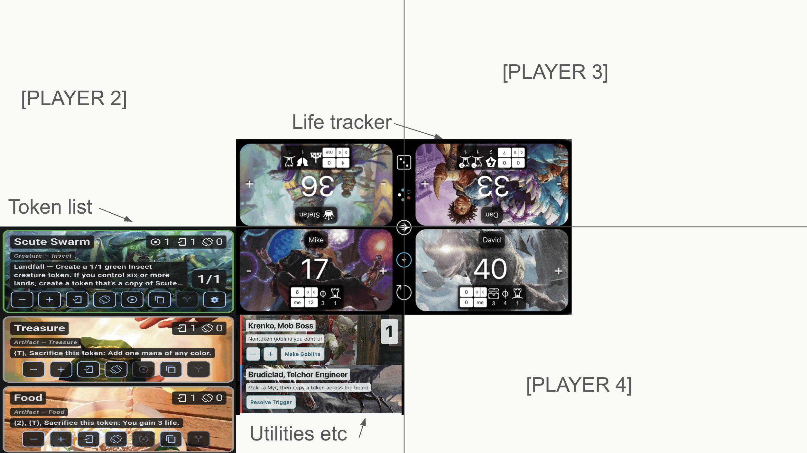

# IPAD EDITION

**Status:** discovery and proposed design; no implementation started.
**Created:** 2026-10-20 (America/Phoenix). **Decisions updated:** 2026-10-21.
**Product relationship:** a separate app / new product reusing Tripling Season infrastructure; the same repository is acceptable with properly isolated directories.
**Technical direction:** Flutter with custom, player-facing in-app keyboards; validate in prototypes before treating the solution as proven. **Product targets:** Android, iOS and web.
**Code baseline:** `8894640543833eaf37bd62b971a0955c26bafa49` on `update-1-11`.

IPAD EDITION turns one shared tablet into a tabletop dashboard: a central life tracker, customizable two-to-four-player spaces, and separate token and utility columns for each player. Each seat has its own actions menu. The center owns game-level controls. Every action must retain its player identity through rules, generated companions, persistence, undo, and delayed work.

This is a planning dossier, not a shipped feature specification. **Confirmed** means directly requested by the user. **Proposed** means a recommendation for discussion. **Open** means a decision is still needed. File names, class names, numeric layout budgets, release scope, and storage designs below are proposals unless described as existing code. The decision register is the authority for approval status; an implementation phase or acceptance scenario does not itself approve a proposal.

## Start here

| Document | Purpose |
|---|---|
| [Product and scope](01_product_and_scope.md) | Confirmed requirements, intended experience, boundaries, candidate first release |
| [Layout and interaction](02_layout_and_interaction.md) | Interpret the sketch, quadrant geometry, orientation, independent lists, menus and simultaneous use |
| [Game history and undo](game_history_and_undo.md) | Chronological game history, action grouping, latest-action undo, persistence and existing-undo audit |
| [Life and game controls](03_life_and_game_controls.md) | Life, commander damage, counters, reset semantics, game lifecycle |
| [Player isolation and rules](04_player_isolation_and_rules.md) | Command ownership, event routing, generated tokens, explicit cross-player operations |
| [Architecture and reuse](05_architecture_and_reuse.md) | Flutter recommendation, current reuse map, project structure and frontend boundary |
| [Data and migration](06_data_persistence_and_migration.md) | Proposed session model, storage, settings scopes, recovery, compatibility |
| [Utilities, tokens and decks](07_utilities_tokens_and_decks.md) | Mana pool, existing utilities, token workflows, deck loading and export |
| [Delivery and validation](08_delivery_validation_and_risks.md) | Dependency-ordered phases, manual acceptance matrix, performance experiments, risks |
| [Decision register](09_decision_register.md) | Stable question IDs, defaults, alternatives, dependencies and review batches |
| [Six-player expansion](six_player_expansion.md) | Deferred expansion to six; preserve design leeway without promising release support |
| [Custom keyboard options](custom_keyboard_options.md) | Deferred mana-symbol and input-option exploration; not a release commitment |
| [Research and sources](10_research_sources.md) | Official Flutter / Magic references, conclusions and unanswered research questions |
| [Current-code audit](../../../../ai_docs/research/2026-10-20-ipad-edition-current-architecture.md) | Evidence of what exists today, separate from the proposed edition |

For a fast design session: read this page, the layout document, and the decision register. For implementation planning: also read the isolation, architecture, data, and acceptance documents before touching providers or models.

## Confirmed direction

- **C01:** This is a separate app and new product. It may live in this repository if isolated properly in its own directories; exact package structure is not selected.
- **C02:** Flutter with a custom player-facing keyboard is the chosen direction, subject to prototype validation rather than a claim of implemented behavior.
- **C03:** Make the life tracker the centerpiece of the app.
- **C04:** Give each player their own token list and utility list, including room for new utilities such as a mana pool.
- **C05:** Give each player an actions menu for creation, board actions, and utilities.
- **C06:** Put universal game-level controls, including resets, in the center.
- **C07:** Reuse existing infrastructure heavily while redesigning the frontend around separate surfaces instead of the current unified board-item list.
- **C08:** Preserve reordering separately within each player's token and utility lists.
- **C09:** Carry player context through all actions and prevent unintended changes in another player's space, including generated companion tokens.
- **C10:** Preserve enough detail, research, options, and outstanding questions to iterate quickly later.

- **C11:** Initial scope is customizable 2–4 players; expansion to six is deferred, with room in the design for it.
- **C12:** Product targets are Android, iOS and web. Device/browser floors and release sequencing remain open.
- **C13:** **Any keyboard input** must face the initiating player, including numeric entry as well as text/search/rename. **One keyboard at a time; no simultaneous keyboards** (D09). Draft-preserving handoff details remain open (D11).
- **C14:** Full life-tracker fundamentals: life totals, relevant player counters including energy/poison/experience, city’s blessing, monarch ownership, game-level day/night, and source-specific commander damage **including self and distinct partner sources**. Use [Lifetap’s functional inventory](lifetap_research.md) as research, not a UI to copy. New commander damage subtracts life as one undoable action with independent corrections; thresholds warn without automatic elimination; monarch/day-night changes are manual. Inventory extensions, detailed correction UI and reset retention remain open; see [life-tracker scope](03_life_and_game_controls.md).

- **C15:** Persistent game-wide chronological history with player attribution, undo walking back the latest action globally, repeated-like-action grouping and separate token add/remove lines. Life taps settle to a net adjustment after roughly 1–2 seconds of inactivity; immediate display is still a recommendation. Any player’s different action closes the active group; exact timeout tuning and past-game archives remain open. See [history and undo](game_history_and_undo.md).

The supplied image establishes a four-player reference, not a fixed participant count. Exact seating orientations, package layout, application identifiers, purchase model, release date and remaining feature inventory are open. See the accepted decisions in the register.

## Original concept

The original, unedited 2508 × 1410 image is preserved in [reference/original-concept.png](reference/original-concept.png). It was supplied by the user on 2026-10-20. The embedded app imagery is a visual reference; its artwork, icons, small controls, player names, and life totals are not automatically new product requirements. Only the lower-left player has fully illustrated lists. The other three spaces require design, not literal empty replicas.

## Additional seating mockups — 2026-10-21

- [Two-player concept](reference/two-player-concept.png): accepted opposite-facing matched layouts; each player sees tokens left, life top right and utilities below life.
- [Three-player concept](reference/three-player-concept.png): accepted three-player arrangement uses a four-seat base with any selectable empty slot for expanded game controls (including quicker dice/reset access). The user clarified that the initial “In 4 player” wording meant three-player. Reset safeguards remain unchanged.

Both original images are retained unedited as user concept evidence, not implementation screenshots or measured acceptance. See [layout details](02_layout_and_interaction.md).

## Foundational recommendations to review

1. Build a **local, offline, shared-device prototype**, using four seats as one fixture and checking two/three-seat layouts; leave network play outside the initial scope.
2. Treat a player ID as stable domain identity and a seat as presentation. Swapping seats must not reassign a board's contents.
3. Enforce player scope at the command and repository boundaries, not only in list filtering.
4. Keep life separate from board items. Give tokens and utilities independent ordering domains.
5. Scope ordinary edits and panels to one player. Reserve a table-wide barrier for intentional game-level operations.
6. Inspect the actual running UI and interactions in the cloud before asking the user to install anything; then prove physical touch, seated usability, native behavior and recovery on actual iPad hardware before release acceptance or large package extraction.

The offline boundary and detailed implementation choices remain proposals. Separate product, 2–4-player initial scope and Android/iOS/web targets are accepted; six-player support is deferred. Resolve remaining choices through [D01–D35](09_decision_register.md).

## Resume and maintenance rules

- Keep this entire directory under `todo_features` while planning. Move it together to `in_progress_features` when implementation actually begins, and repair relative links.
- Update decision status with date, rationale, and affected documents; preserve IDs so discussions remain traceable.
- Record prototype results as measured outcomes, including device, viewport, text scaling, build mode, and failures. All validation in this initial dossier is **planned / not run**.
- Move to `new_release` only after the agreed acceptance work passes and implementation is committed. This dossier does not alter the current 1.11 queue.
- Keep current-code evidence distinct from product proposals. Re-audit source references when the baseline changes.
- Preserve the existing app's Hive IDs, boxes, user data, and accepted phone behavior. A new project is not authorization to migrate or overwrite the phone app.

## Documentation review checkpoint — 2026-10-20

The dossier received separate frontend, isolation/event, and persistence reviews. Review corrections aligned command-writer proposals, player/session invalidation, immutable event-time data, numeric utility fixtures, format-import coverage, and phase dependencies. Relative file targets, decision/validation IDs and Markdown fence balance were checked; the source audit's baseline paths/line ranges were verified against Git objects. These are documentation checks only. No IPAD EDITION app build, device experiment or acceptance scenario has run, and all product decisions were open at that checkpoint. The 2026-10-21 accepted decisions below supersede that historical status.

## Decision update — 2026-10-21

Recorded separate-product, cross-platform and 2–4-player decisions; retained six-player expansion and custom keyboard options as deferred documents. All keyboard input must face its initiating player. The subsequent explicit answer “No simultaneous keyboards.” settles one keyboard at a time; detailed handoff behavior remains open. No app code, build configuration or acceptance result is changed by this documentation update.

## Terminology

| Term | Meaning |
|---|---|
| Table / game session | One shared game containing participants and table-level settings |
| Player | Stable participant identity within that session; not an authenticated account |
| Seat / quadrant | Screen placement and orientation, which can change without changing player identity |
| Token lane | One player's independently ordered token stacks |
| Utility lane | One player's independently ordered utilities; existing internal `Widget` names may remain |
| Life panel | One player's view into central life state; never a draggable token/utility entry |
| Actor | Player initiating a command; does not imply the UI can identify the human touching glass |
| Target | Player or object explicitly affected by a command |
| Owner / controller | Magic concepts reserved for future explicit control-transfer support; do not conflate with a screen coordinate |
| Companion token | Informal name for an additional generated token, such as a Squirrel; not the Magic companion mechanic |
